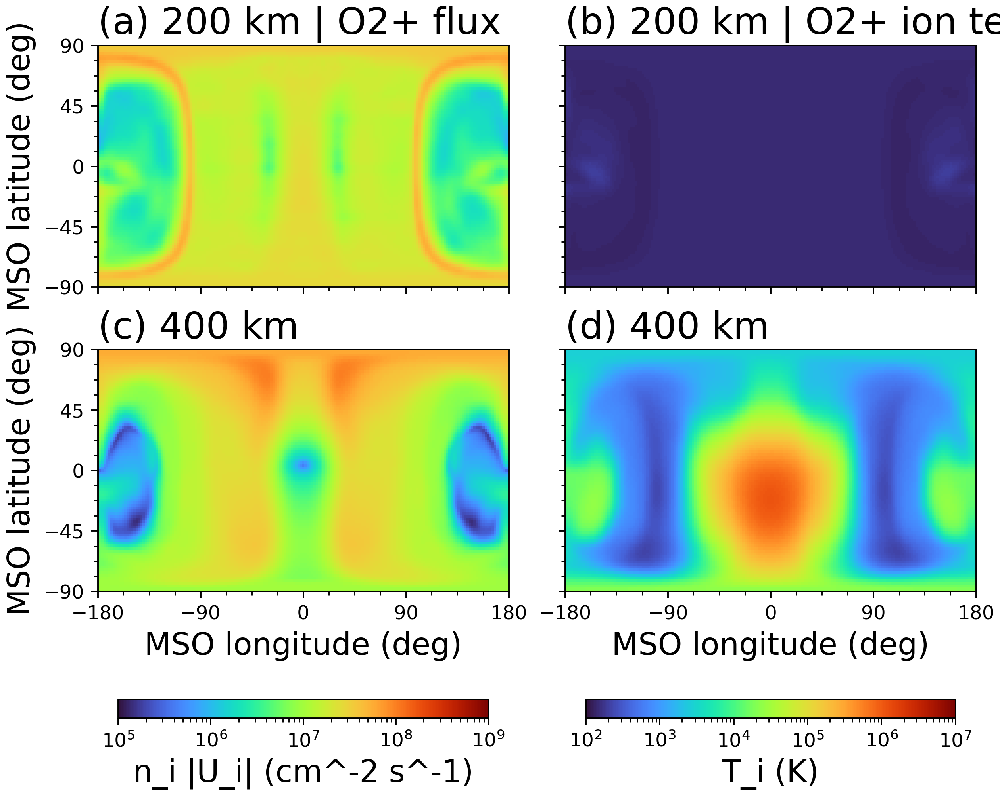
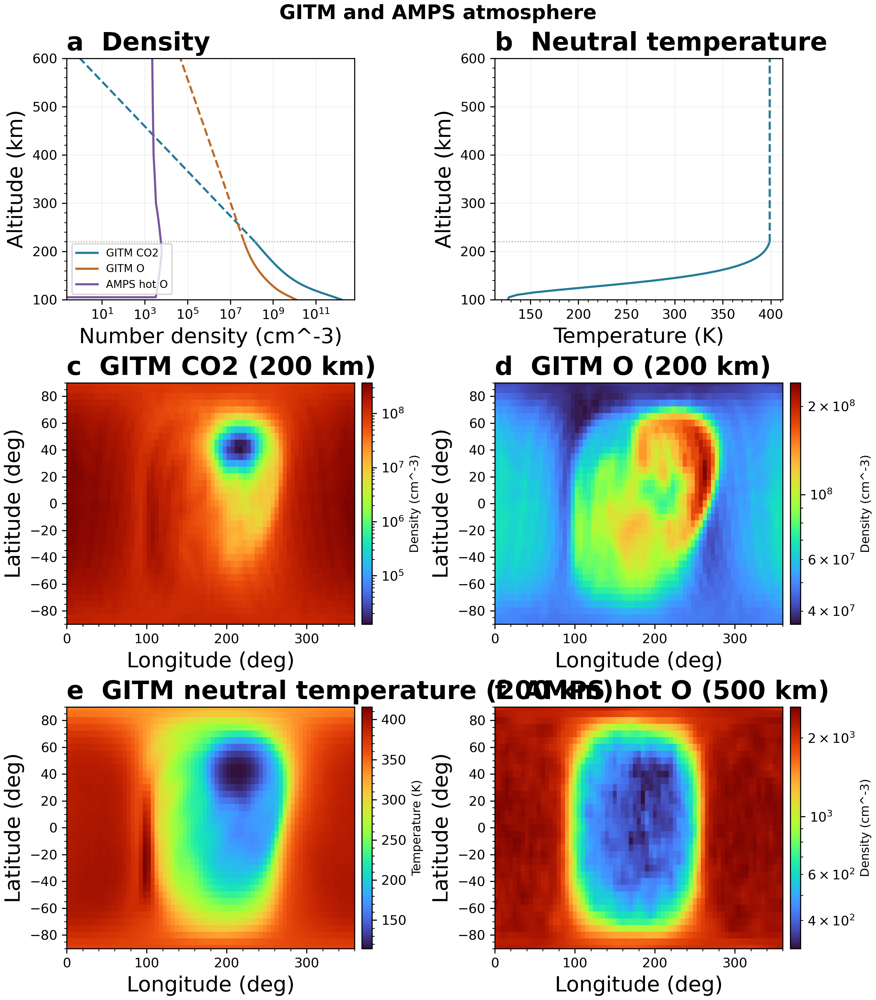

# Background models: MHD, GITM and AMPS

This directory provides maps of electromagnetic fields, ion moments and neutral atmosphere parameters. Physical inputs remain in the repository `data/` directory.

## MHD O₂⁺ flux and temperature



Maps at 200 and 400 km show `n*norm(Ui)` on the left and ion temperature on the right. Spherical angles are defined relative to the model axes. Anomalous south-pole samples are masked for display. See [map definitions](ionosphere_maps.md).

```sh
julia --project=. examples/background_models/plot_ionosphere_maps.jl
```

The plotting script calls [sample_ionosphere_maps.jl](sample_ionosphere_maps.jl). To reuse saved samples:

```sh
julia --project=. examples/background_models/plot_ionosphere_maps.jl outputs/ionosphere_maps_<timestamp>
```

## GITM and AMPS



The figure includes GITM neutral density and temperature profiles and 200 km maps, plus AMPS hot oxygen profiles and a 500 km map. AMPS does not provide temperature. See [atmospheric assumptions](atmosphere.md).

```sh
julia --project=. examples/background_models/plot_atmosphere.jl
```

Additional multi-altitude flux and speed maps can be generated with:

```sh
julia --project=. examples/background_models/plot_outflow_500km.jl
julia --project=. examples/background_models/plot_outflow_altitudes.jl
julia --project=. examples/background_models/plot_speed_altitudes.jl
julia --project=. examples/background_models/plot_speed_inward_altitudes.jl
julia --project=. examples/background_models/plot_speed_outward_altitudes.jl
```

Figures are saved in `images/` and `outputs/`.

## Inputs and dependencies

- MHD: `data/mars_fields_spherical_from_dat.vts`, fields and ion moments; generated via `julia --project=. scripts/convert_batsrus_mhd.jl`.
- GITM: `data/gitm_sph.mat`, neutral atmosphere parameters.
- AMPS: `data/amps_sph.mat`, hot oxygen density.
- Julia: the repository Project.toml/Manifest.toml environment (`PyPlot` for Matplotlib rendering), with `julia` on PATH.

Run from the repository root. Scripts do not install dependencies automatically. Return to [examples](../README.md).
