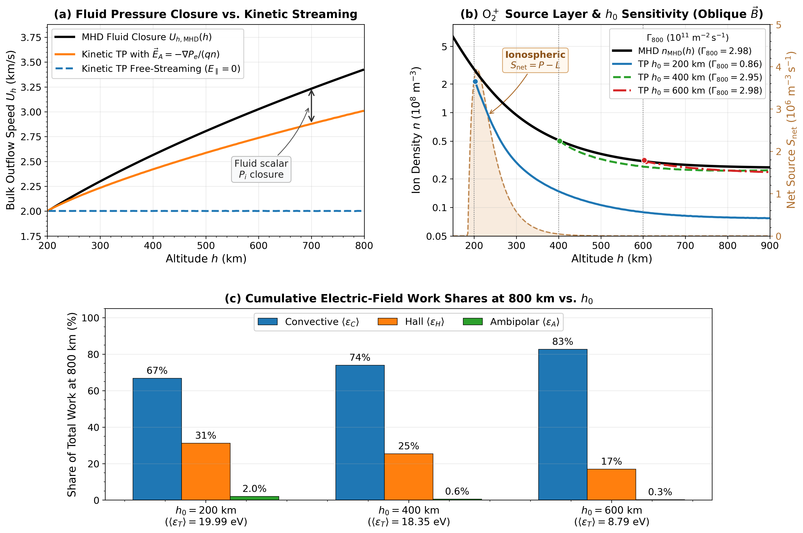

# Source Altitude Sensitivity and Test-Particle vs. MHD Discrepancy



Even when background electromagnetic fields are in an exact steady state and $\mathrm{O}_2^+$ test particles ($m = 32\ \mathrm{amu}$) are initialized directly from the local MHD Maxwellian moments ($n_{\mathrm{MHD}}, \mathbf{U}_{\mathrm{MHD}}, T_i$), the phase-space density (PSD) and fluid moments ($n_{\mathrm{TP}}, \mathbf{U}_{\mathrm{TP}}, T_{\mathrm{TP}}$) reconstructed from collisionless forward tracing systematically depart from the global MHD fluid profiles and depend on the launch altitude $z_0$. At the same time, the relative electric-field energization shares ($\langle W_C \rangle, \langle W_H \rangle, \langle W_A \rangle$) remain robust across launch altitudes.

This example uses a unified 1D analytical model of the Martian dayside ionosphere ($z \in [150, 800]\ \mathrm{km}$, $g = 0$, matching Manuscript Equations 1–6) implemented in [`src/analysis/tp_mhd_discrepancy.jl`](../../src/analysis/tp_mhd_discrepancy.jl) and run via [`tp_mhd_discrepancy_benchmark.jl`](tp_mhd_discrepancy_benchmark.jl).

---

## 1. Physical Model: 1D Oblique Draped Ionospheric Outflow Column

In steady state, the 1D MHD continuity and vertical momentum equations for isothermal $\mathrm{O}_2^+$ outflow ($T_i = 1500\ \mathrm{K}$, $T_e = 2000\ \mathrm{K}$, $v_{\mathrm{th}} = \sqrt{k_B T_i / m} \approx 0.62\ \mathrm{km/s}$) are:

$$
\frac{d}{dz}\left(n_{\mathrm{MHD}} U_z\right) = S_{\mathrm{net}}(z) = P(z) - L(z), \qquad
m n_{\mathrm{MHD}} U_z \frac{dU_z}{dz} = \left(\mathbf{J}\times\mathbf{B}\right)_z - \frac{dP_e}{dz} - \frac{dP_i}{dz}
$$

Using the generalized Ohm's law with massless electrons ($m_e \to 0$):

$$
\mathbf{E} = -\mathbf{U}_i \times \mathbf{B} + \frac{\mathbf{J}\times\mathbf{B}}{q n_e} - \frac{\nabla P_e}{q n_e} = \mathbf{E}_C + \mathbf{E}_H + \mathbf{E}_A
$$

Substituting $\mathbf{E}$ into the fluid momentum equation yields:

$$
m U_z \frac{dU_z}{dz} = q\left(\mathbf{E} + \mathbf{U}\times\mathbf{B}\right)_z - \frac{1}{n_{\mathrm{MHD}}}\frac{dP_i}{dz}
$$

In `AnalyticalOutflowColumn`, the magnetic field is an **oblique draped pileup field** $\mathbf{B}(z) = (B_x(z), 0, B_z)$ with constant vertical component $B_z = 5\ \mathrm{nT}$ and sheared horizontal pileup $B_x(z)$ decreasing from $\sim 28\ \mathrm{nT}$ in the lower ionosphere to $14\ \mathrm{nT}$ at $800\ \mathrm{km}$ (Panel **a**), so that $\mathbf{J} = \frac{1}{\mu_0}\frac{dB_x}{dz}\hat{\mathbf{y}}$ drives a self-consistent Hall electric field $\mathbf{E}_H = (\mathbf{J}\times\mathbf{B})/(q n_e)$ alongside the convective field $\mathbf{E}_C = -\mathbf{U}\times\mathbf{B}$ and ambipolar field $\mathbf{E}_A = -\nabla P_e / (q n_e)$.

---

## 2. Three Fundamental Sources of TP–MHD Discrepancy

### Mechanism 1: Boundary Volume-Maxwellian Weighting vs. Residence-Time Flux Reconstruction (Panel b)

In Manuscript Equations 2–4, particles injected at a boundary patch of area $A$ are assigned weights proportional to the **volume Maxwellian**:

$$
g(\mathbf{V}_i) = \exp\left(-\frac{m|\mathbf{V}_i - \mathbf{U}|^2}{2 k_B T_i}\right), \qquad
w_i = Q \frac{g(\mathbf{V}_i)}{\sum_k g(\mathbf{V}_k)}, \qquad Q = n |\mathbf{U}| A
$$

When a virtual detector of thickness $\Delta z$ reconstructs the phase-space density from particle residence times $\tau_i = \Delta z / v_{z,i}$ (Manuscript Equation 6), each particle contributes $w_i \tau_i \propto g(\mathbf{V}_i) / v_{z,i}$:

$$
f_{\mathrm{TP}}(\mathbf{V}) \propto \frac{g(\mathbf{V})}{v_z} \neq f_{\mathrm{MHD}}(\mathbf{V})
$$

Because $w_i$ is a boundary **injection rate** ($\mathrm{s}^{-1}$, particles crossing a surface per unit time), Liouville's theorem requires weighting boundary-injected particles by the **one-way kinetic flux distribution** $w_i \propto v_n g(\mathbf{V})$ ($v_n = \mathbf{V}\cdot\hat{\mathbf{n}} > 0$) so that $v_n$ cancels $\tau_i = \Delta z / v_n$. As shown in Panel **(b)**, volume weighting (red dashed) overweights slow particles by $1/v_z$, inflating low-$v_z$ density and reducing the reconstructed bulk speed whenever the launch flow is subsonic or transonic ($U_0 \lesssim v_{\mathrm{th}}$), whereas flux weighting (blue dotted) recovers $f_{\mathrm{MHD}}(v_z)$ exactly.

### Mechanism 2: Collisional Fluid Closure ($-\nabla P_i$) and Volumetric Production ($S_{\mathrm{net}}$) vs. Collisionless Free-Streaming (Panel c)

Whereas $m_e \to 0$ turns $-\nabla P_e$ into a true electrostatic field $\mathbf{E}_A = -\nabla P_e / (q n_e)$ in Ohm's law that acts directly on every test particle via the Lorentz force $q\mathbf{E}$, the ion pressure gradient $-\nabla P_i$ in the MHD momentum equation is **not** an electric field. In kinetic theory, $\nabla\cdot\mathbf{P}_i$ arises from the velocity moment of spatial advection ($\mathbf{v}\cdot\nabla f$). In a collisional fluid, frequent collisions continuously re-isotropize the ions and convert thermal enthalpy into bulk outflow acceleration.

By contrast, collisionless test particles launched from a single shell $z_0$ along a parallel field ($\mathbf{B} = B_0\hat{\mathbf{z}}$, Panel **c**) without inter-particle collisions or volumetric sources above $z_0$ cannot convert thermal pressure into bulk flow acceleration:
- With $E_\parallel = 0$ (`:conv_only`, blue dashed), particles coast at constant $v_z(z) = v_z(z_0)$ and reach only $U_z(600\ \mathrm{km}) = 0.75\ \mathrm{km/s}$.
- Adding the ambipolar field $\mathbf{E}_A = -\nabla P_e / (q n_e)$ (`:conv_amb`) accelerates ions only to $1.31\ \mathrm{km/s}$ from $z_0 = 200\ \mathrm{km}$ (orange) or $2.35\ \mathrm{km/s}$ from $z_0 = 400\ \mathrm{km}$ (green), compared to $U_{z,\mathrm{MHD}}(600\ \mathrm{km}) = 3.85\ \mathrm{km/s}$.
- In multi-species MHD, $\mathbf{E}_C = -\mathbf{U}_i \times \mathbf{B}$ uses the mass-weighted center-of-mass ion velocity $\mathbf{U}_i = (\sum_s \rho_s \mathbf{U}_s)/(\sum_s \rho_s)$ rather than the individual $\mathrm{O}_2^+$ velocity $\mathbf{U}_{\mathrm{O}_2^+}$.
- Including the volumetric source $S_{\mathrm{net}}(z)$ and the effective fluid-closure force $-\nabla P_i / (q n)$ (red dotted) closes the momentum equation and reproduces $U_{z,\mathrm{MHD}}(z)$.

### Mechanism 3: Finite-Larmor-Radius (FLR) Gyromotion, Back-Gyration Loss, and Polarization Drift (Panels d & e)

In global MHD, the gyroradius is zero ($r_L \to 0$): the fluid moves at the local drift velocity and remains an isotropic Maxwellian at every altitude. Full-orbit $\mathrm{O}_2^+$ ions traced in the oblique draped field $\mathbf{B} = B_x(z)\hat{\mathbf{x}} + B_z\hat{\mathbf{z}}$ exhibit two kinetic departures:
1. **Launch-altitude sensitivity ($z_0 = 200, 300, 400\ \mathrm{km}$, Panel d):** A single-shell launch at $z_0$ omits all volumetric production $S_{\mathrm{net}}(z)$ above $z_0$ (which peaks at $200\text{–}350\ \mathrm{km}$), and particles initialized with $v_y(0) > 0$ experience an initial downward Lorentz force $-q v_y B_x < 0$ that causes a large fraction of the thermal ensemble to gyrate into the $200\ \mathrm{km}$ inner absorption boundary when $U_z(z_0) \lesssim v_{\mathrm{th}}$. Consequently, the surviving flux at $600\ \mathrm{km}$ increases from $2.1\times 10^{11}$ ($z_0 = 200\ \mathrm{km}$) to $10.5\times 10^{11}$ ($z_0 = 300\ \mathrm{km}$) and $13.0\times 10^{11}\ \mathrm{m^{-2}s^{-1}}$ ($z_0 = 400\ \mathrm{km}$, capturing $94\%$ of the MHD flux $13.8\times 10^{11}\ \mathrm{m^{-2}s^{-1}}$). Progressively restoring flux weighting, volumetric production $S_{\mathrm{net}}(z)$, and the small-$r_L$ fluid limit (red dotted curve in Panel **d**) recovers the exact $n_{\mathrm{MHD}}(z)$ profile across the entire column.
2. **Polarization drift and non-Maxwellian VDFs (Panel e):** Upward cross-field acceleration in a spatially varying $\mathbf{E}_C(z) = -U_z(z) B_x(z)\hat{\mathbf{y}}$ requires a finite polarization drift $v_y = -\frac{1}{\Omega_c}\frac{dv_z}{dt} \approx -\frac{U_z}{\Omega_c}\frac{dU_z}{dz} < 0$. As shown in Panel **(e)**, the reconstructed 2D VDF $f_{\mathrm{TP}}(v_y, v_z)$ at $z_c = 600\ \mathrm{km}$ is shifted to $v_y \approx -0.68\ \mathrm{km/s}$ and forms an asymmetric ring-beam distribution rather than the local isotropic MHD Maxwellian (white circles centered at the red star).

---

## 3. Robustness of Electric-Field Work Partition ($\mathbf{E}_C, \mathbf{E}_H, \mathbf{E}_A$) to Launch Altitude $z_0$ (Panel f)

Despite the strong sensitivity of absolute density $n_{\mathrm{TP}}(z)$ and total escape flux $\Gamma_{\mathrm{TP}}$ to the launch altitude $z_0$, Panel **(f)** demonstrates that the **relative cumulative work shares** performed by the convective ($\langle W_C \rangle$), Hall ($\langle W_H \rangle$), and ambipolar ($\langle W_A \rangle$) electric fields on escaping trajectories reaching $z_c = 600\ \mathrm{km}$ are remarkably insensitive to $z_0$:
- $z_0 = 200\ \mathrm{km}$: $56.2\%$ convective, $40.7\%$ Hall, $3.2\%$ ambipolar
- $z_0 = 300\ \mathrm{km}$: $58.2\%$ convective, $34.1\%$ Hall, $7.7\%$ ambipolar
- $z_0 = 400\ \mathrm{km}$: $59.4\%$ convective, $35.4\%$ Hall, $5.2\%$ ambipolar

Because the relative energization along escaping trajectories is governed by the macroscopic electromagnetic field geometry above the main production peak rather than by low-altitude boundary absorption, initializing the 3D global Monte Carlo ensemble at $z_0 = 400\ \mathrm{km}$ captures over $94\%$ of the asymptotic outflow flux while preserving the physical partition of electric-field work.

---

## 4. Running the Benchmark

From the repository root:

```sh
julia --threads=auto --project=. examples/forward_tracing/tp_mhd_discrepancy_benchmark.jl
```

This invokes `AnalyticalOutflowColumn`, `benchmark_weighting_vdf`, and `trace_outflow_column` from `MarsTP` and writes `examples/forward_tracing/images/tp_mhd_discrepancy_6panel.png`.

To regenerate Appendix Figure A1 directly in the companion `MarsO2+` manuscript repository:

```powershell
$env:TP_MHD_BENCHMARK_OUTPUT = "C:/Users/henry/Documents/Research/MarsO2+/figures/figA1.png"
julia --threads=auto --project=. examples/forward_tracing/tp_mhd_discrepancy_benchmark.jl
```

